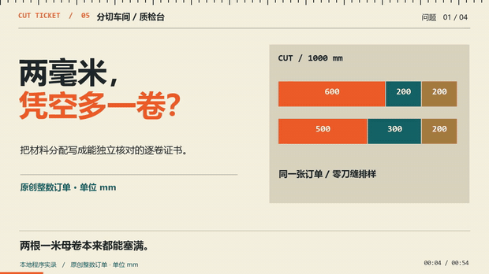

# 两卷够不够？

车间有一米长的母卷，订单需要 600、500、300 和三件 200 毫米的成品。总长度恰好两米，却可能得领三卷料。这里可以亲自查每一把刀和每一段余料。

[](demo/demo.mp4)
[播放中文演示](demo/demo.mp4) · [中文字幕](demo/字幕.srt) · [真实命令行时间记录](demo/session.cast)

54 秒。00:12 摊开每一卷排样，00:26 查 66 个订单的独立复核，00:40 看篡改证书被退回。

## 本地一键复演

在仓库根目录运行。使用 Python 3.11 或 3.12 标准库，无需联网或 GPU。入口按脚本位置查找数据，复制或重命名仓库后仍可使用。每次运行会将科研程序和原始输入复制到新的临时目录，重新计算并打印关键读数。

```sh
python -X utf8 demo/replay.py
```

## 核验一张下料单

在零刀缝模型里，两卷分别为 `600+200+200` 与 `500+300+200`。刀缝改成 2 毫米后，精确最优解用三卷，余料为 98、96、800 毫米。[原始短订单](附件/data/orders.json) · [逐卷排样与搜索证据](附件/results.json)

稳健实验为每单冻结允许的刀缝、齐边和尾刀条件，并用独立子集算法查最优卷数。66 单全部一致；仅检查刀缝端点会低估 3 单，忽略尾刀会使 34 单失去安全保证。66 单含一例合理判定不可行。重复编号、改长度、漏情景、改余料、少报卷数五种篡改均被识别。[稳健输入](附件/data/robust_orders.json) · [逐卷证书](附件/逐卷证书.json) · [审计结果](附件/稳健复核.json)

要导出并保存自己的核验文件，可在仓库根目录运行：

```sh
python -X utf8 附件/robust_audit.py --audit 审计输出.json --certs 证书输出.json
```

所有订单都是原创整数长度教学实例，可复制、修改、公开演示。精确求解针对短订单；生产设备的连续误差、排刀间距和额外机械约束要作为新的模型输入。

## 研究与演示材料

[一页说明](一页说明.pdf) · [完整研究报告](研究报告.pdf) · [展架海报](海报.pdf) · [答辩幻灯片](答辩.pptx) · [Mira 分轮工作流](附件/Mira%20工作流.md)

视频展示本地 Python 程序的实际复算与输出，图形和中文配音用于解读。Mira 桌面端可按分轮工作流导入相同材料；当前演示不含 Mira 对话分享链接。


[下载独立工作流附件 ZIP](B05-roll-cut-certificate-附件包.zip)


[下载 80 × 200 cm 印刷海报 PDF](海报.pdf) · [下载 300 dpi 海报 JPG](海报.jpg)
